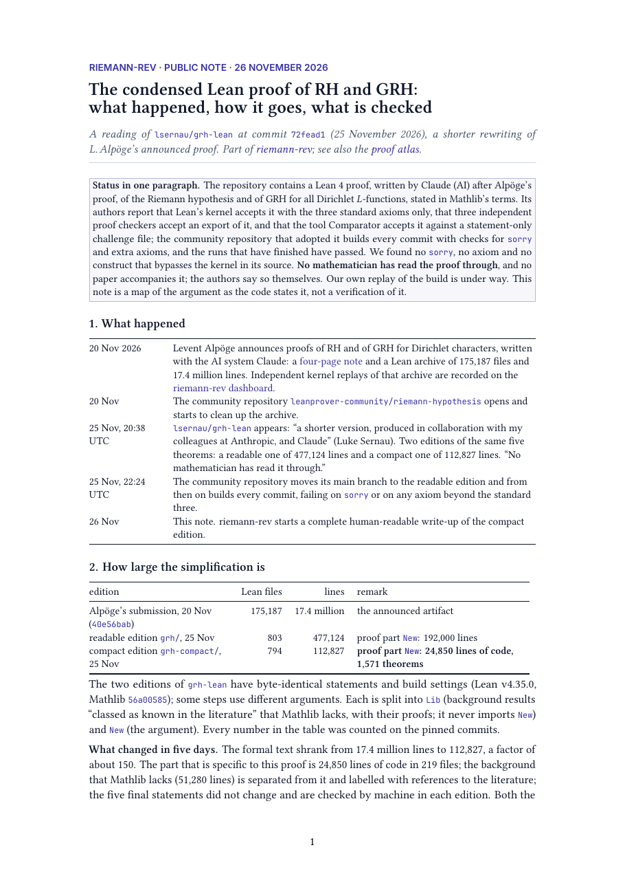
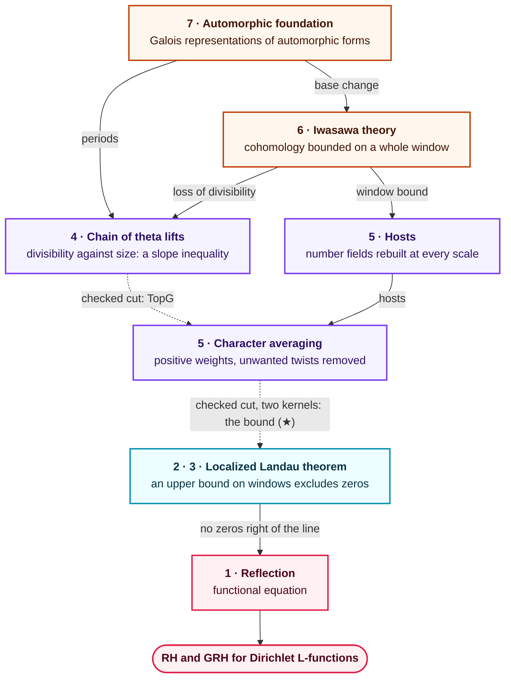

<div align="center">

# The announced proof of the Riemann hypothesis

**A map, a guide and a verification dashboard for the formal proof announced by Levent Alpöge on 20 November 2026, and for its condensed rewriting of 25 November**

<a href="https://nasqret.github.io/riemann-rev/"></a>

<a href="#the-condensed-proof-25-november-2026"></a> <a href="#status-dashboard"></a> <a href="#every-recorded-check-of-the-complete-proof"></a> <a href="#the-theorem"></a> <a href="#status-dashboard"></a>

<a href="#how-this-page-stays-current"></a> <a href="https://github.com/Deicyde/riemann-hypothesis/tree/40e56bab026552e089d7afcfeff08d2defb9c005"></a>  <a href="https://github.com/leanprover-community/mathlib4/tree/0df444a360eaa60ab8c11dca51a86af692955474"></a> <a href="https://github.com/nasqret/riemann-rev/actions/workflows/checks.yml"></a> <a href="https://github.com/nasqret/riemann-rev/actions/workflows/pages.yml"></a>

**New:** [the condensed proof, our note (PDF)](https://nasqret.github.io/riemann-rev/summary/grh-condensed-summary.pdf) · [lsernau/grh-lean](https://github.com/lsernau/grh-lean/tree/72fead102f663d5c7a407964a13dc0cf9d977207)

**Read it online:** [site](https://nasqret.github.io/riemann-rev/) · [atlas](https://nasqret.github.io/riemann-rev/atlas/) · [proof atlas](https://nasqret.github.io/riemann-proof-atlas/) · [guide](https://nasqret.github.io/riemann-rev/guide/proof-guide.pdf) · [book](https://nasqret.github.io/riemann-rev/book/) · [blueprint](https://nasqret.github.io/riemann-rev/blueprint/atlas-blueprint.pdf)

[The condensed proof](#the-condensed-proof-25-november-2026) · [Status](#status-dashboard) · [The theorem](#the-theorem) · [New here?](#new-here-start-here) · [Route of the proof](#the-route-of-the-proof) · [Contents](#what-is-in-this-repository) · [Check it yourself](#check-it-yourself) · [Transparency](#transparency) · [FAQ](#questions-and-answers)

</div>

> [!IMPORTANT]
> **What this page is.** A map of an announced proof and a record of who has checked what. It is not a proof, not a referee report and not an endorsement, and it is not an official companion to the announcement.
>
> **What is claimed.** On 20 November 2026 Levent Alpöge announced, in a four-page note written with the AI system Claude, a proof of the Riemann hypothesis and of its analogue for Dirichlet $`L`$-functions. The proof was published only as a formal proof in the Lean proof assistant: 175,187 files that a computer can check, and that no human is expected to read from beginning to end.
>
> **Where things stand** (record of 2026-11-20 23:51 UTC). Two independent kernels accepted the complete proof, and all five theorems matched the canonical Mathlib challenge. The human-readable mathematics has not been written up yet, and the argument has not been through the traditional refereeing of the mathematical community. Nothing here is this repository's own claim that the theorem is true; it reports the records listed below, with their sources.

## The condensed proof (25 November 2026)

> [!NOTE]
> **The same five theorems in 112,827 lines of Lean instead of 17.4 million.** On 25 November 2026 [`lsernau/grh-lean`](https://github.com/lsernau/grh-lean/tree/72fead102f663d5c7a407964a13dc0cf9d977207) appeared: a rewriting of the proof "produced in collaboration with my colleagues at Anthropic, and Claude" (Luke Sernau), in two editions with byte-identical statements. The argument itself, the folder `New` of the compact edition, is **24,850 lines of code** (1,571 theorems); the background that Mathlib lacks is separated in `Lib` and labelled with references to the literature. Machines have checked it; **no mathematician has read it yet**, as its authors say.
>
> **[Read our note: what happened, how the argument goes, what is checked (PDF)](https://nasqret.github.io/riemann-rev/summary/grh-condensed-summary.pdf)** · every Lean name in it links to its line at the pinned commit.

<p align="center"><a href="https://nasqret.github.io/riemann-rev/summary/grh-condensed-summary.pdf"></a></p>

### What happened

| date (2026) | event |
| --- | --- |
| 20 Nov | Levent Alpöge announces the proof, written with Claude: a [four-page note](https://alpo.ge/remark.pdf) and a Lean archive of 175,187 files, 17,374,215 lines. Independent kernel replays: [the dashboard below](#status-dashboard). |
| 20 Nov | The community repository [`leanprover-community/riemann-hypothesis`](https://github.com/leanprover-community/riemann-hypothesis) opens and starts to clean up the archive. |
| 25 Nov, 20:38 UTC | [`lsernau/grh-lean`](https://github.com/lsernau/grh-lean/tree/72fead102f663d5c7a407964a13dc0cf9d977207) is published: a readable edition (`grh/`, 477,124 lines) and a compact one (`grh-compact/`, 112,827 lines) of the same five theorems. |
| 25 Nov, 22:24 UTC | The community repository moves its main branch to the readable edition; its CI builds every commit and fails on `sorry` or on any axiom beyond the standard three. |
| 26 Nov | This repository publishes the note above and starts a complete human-readable write-up of the compact edition. |

### How large the simplification is

| edition | Lean files | lines | lines of code | the argument (`New`) | background (`Lib`) |
| --- | ---: | ---: | ---: | ---: | ---: |
| Alpöge's submission ([`40e56bab`](https://github.com/Deicyde/riemann-hypothesis/tree/40e56bab026552e089d7afcfeff08d2defb9c005)) | 175,187 | 17,374,215 |  |  |  |
| readable edition [`grh/`](https://github.com/lsernau/grh-lean/tree/72fead102f663d5c7a407964a13dc0cf9d977207/grh) | 803 | 477,124 | 299,899 | 122,391 lines of code | 177,489 lines of code |
| compact edition [`grh-compact/`](https://github.com/lsernau/grh-lean/tree/72fead102f663d5c7a407964a13dc0cf9d977207/grh-compact) | 794 | 112,827 | 76,149 | **24,850 lines of code, 1,571 theorems** | 51,280 lines of code |

Counted by `scripts/measure_condensed.py` on the pinned commits: the compact edition is 154 times shorter than the submission, the readable one 36 times. `Lib` never imports `New`. A scan of both editions finds 0 uses of `sorry`, `axiom`, `opaque`, `unsafe`, `native_decide`, `implemented_by`, custom syntax or code run at compile time.

### How the argument goes, in five lines

1. **GRH from a one-sided bound for primes** ([`entireL_ne_zero_of_primeError_le`](https://github.com/lsernau/grh-lean/blob/72fead102f663d5c7a407964a13dc0cf9d977207/grh-compact/src/New/Endgame/OneSidedCriterion.lean#L28)): an upper bound $`x^{-1/2+\varepsilon}`$ for a weighted count of the primes that do not split in $` ℚ(\sqrt{-d})`$ rules out zeros with real part above one half; only one side is needed because the weights are non-negative (Landau 1905).
2. **The bound from the main inequality** ([`star_inequality`](https://github.com/lsernau/grh-lean/blob/72fead102f663d5c7a407964a13dc0cf9d977207/grh-compact/src/New/Main.lean#L121)), with about $`\sqrt{\mathstrut x}`$ theta lifts: "the saving $`x^{-1/2}`$ is $`1/m`$".
3. **The main inequality from one covolume bounded from both sides**, for a lattice of theta lifts between unitary groups over a CM field.
4. **Upper bound:** Theorem A, short forms, and Theorem B, enough forms ([`ShortAndEnough`](https://github.com/lsernau/grh-lean/blob/72fead102f663d5c7a407964a13dc0cf9d977207/grh-compact/src/New/Endgame/ShortAndEnough.lean#L138)).
5. **Lower bound:** Theorem C, integral forms are long ([`integral_forms_long`](https://github.com/lsernau/grh-lean/blob/72fead102f663d5c7a407964a13dc0cf9d977207/grh-compact/src/New/Endgame/LongForms.lean#L63)), by the product formula for heights, with one twist for each prime chosen through Galois representations and Selmer groups.

The main amount appears in both bounds and cancels. The note explains each step and lists what is quoted from the literature: class field theory, Galois representations of eigenforms, $`p`$-adic Hodge theory, Shimura varieties, the Siegel–Weil and Rallis formulas, a bound for odd Tate–Shafarevich groups after Mazur–Wiles and Greither, and more, all proved inside `Lib`, not assumed. The theorem of Ferrero and Washington, central to the submission's route, is cited in neither edition.

### What is checked, and what is not

- **Reported by the authors:** every file builds without `sorry`; `#print axioms` lists only `propext`, `Classical.choice`, `Quot.sound`; the exported proof is accepted by nanoda, con-leche and con-ron; Comparator accepts the five theorems against [`Challenge.lean`](https://github.com/lsernau/grh-lean/blob/72fead102f663d5c7a407964a13dc0cf9d977207/grh-compact/Challenge.lean).
- **By the community:** CI builds every commit of the readable edition and fails on `sorry` or extra axioms; the runs that have finished have passed.
- **By us:** the source scan above, the statements read, and an independent replay of the build on a cluster, under way.
- **By nobody yet:** a mathematician's reading of the argument.

The rest of this page records the **submission of 20 November**: its checks, its route and the notes on parts of it. A complete write-up of the compact edition, every classical input quoted by reference, is in progress here.

> [!TIP]
> **The proof atlas: [nasqret.github.io/riemann-proof-atlas](https://nasqret.github.io/riemann-proof-atlas/).** The theorems and lemmas of the archive placed on a map of the arXiv literature by subject. Search a Lean name, follow a theorem from its mathematical neighbourhood to its Lean code and to the endpoints that depend on it, and read the chapters on three levels: statements, structured proofs and Lean, beside the notes. Built by the reading project; the paper map is Leland McInnes's map of arXiv.

<p align="center"><a href="https://nasqret.github.io/riemann-proof-atlas/"></a></p>

## Status dashboard

Record of the reading project as of **2026-11-20 23:51 UTC**, imported here on 2026-11-21 00:17 UTC. [How this page stays current](#how-this-page-stays-current) · [Where to follow the sources](#where-to-follow-the-sources)

<p align="center">     </p>

| Question | Answer | Record |
| --- | --- | --- |
| Do the formal statements really say RH and GRH? | ✅ **Yes, as far as a machine can tell.** The first theorem has Mathlib's own type `RiemannHypothesis`, and the five statements were compared with a challenge written independently of the proof. | • Official comparison with the independent Mathlib challenge (the reading project): **All five canonical statements matched**<br>• Recreate the reference from the five handwritten Mathlib statements (the reading project): **All 350,862,311 bytes identical**<br>• Five theorems justified by con-leche in verified mode (Szymon Teżewski): **Accepted by this operator** ([source](https://leanprover.zulipchat.com/#narrow/channel/113488-general/topic/Discussion.3A.20Alp.C3.B6ge.20Proves.20the.20Riemann.20Hypothesis/near/642355040)) |
| Does a proof checker accept the complete proof? | ✅ **Yes, two independent ones.** Lean's kernel checks every step; NanoDA is a second kernel, written independently in Rust. | • Fresh Rust verification of the complete proof (the reading project): **1,484,733 declarations accepted**<br>• Combined kernel and challenge check (the reading project): **All five named proofs justified** |
| Has anyone else reproduced that? | ✅ **Yes.** 4 parties outside the reading project report accepting runs of their own, from their own builds. | • **Simon DeDeo**: Second full original Lean kernel replay — 175,187 of 175,187 accepted ([source](https://photos.proofsandreasons.io/wright/alp-replay.json))<br>• **Elliot Arledge**: Independent rebuild and separately generated export — 1,484,729 declarations accepted ([source](https://github.com/Infatoshi/rh-verification-receipts/blob/ac99f18cef21952de094234fab95db342ed16638/VERIFICATION_RESULT.txt))<br>• **Andrew Sutherland**: Original Lean build — Accepted, and 3 more ([source](https://math.mit.edu/~drew/grh/))<br>• **Szymon Teżewski**: Five theorems justified by con-leche in verified mode — Accepted by this operator ([source](https://leanprover.zulipchat.com/#narrow/channel/113488-general/topic/Discussion.3A.20Alp.C3.B6ge.20Proves.20the.20Riemann.20Hypothesis/near/642355040)) |
| Which axioms does the proof rest on? | ✅ **Only the three standard axioms of Lean**: `propext`, `Classical.choice`, `Quot.sound`. No additional assumption about primes or zeros is hidden anywhere. | • Exact axiom set of each exported proof (the reading project): **15 of 15 paths witnessed**<br>• Five transitive axiom lists (Andrew Sutherland): **All five published** ([source](https://math.mit.edu/~drew/grh/audit.log)) |
| Is the mathematics understood and refereed? | ⏳ **Not yet.** A kernel certifies that the theorem follows from the axioms. It does not explain why, and it is no substitute for mathematicians reading the argument. No human-readable proof exists so far; this repository is one attempt to map the formal one. | [What a formal check does and does not establish](#what-a-formal-check-does-and-does-not-establish) |
| What has this repository checked itself? | ✅ The logical skeleton of the argument compiles in Lean 4.35.0 with no axioms (10 axiom-free declarations); the last step (no zeros right of the line ⇒ Mathlib's `RiemannHypothesis`) is re-proved independently against Mathlib; the numbers in the figures are computed and asserted. | [axiom report](verification/logs/axioms.json) · [Mathlib check](verification/logs/mathlib-zeta-axioms.json) · [computed facts](assets/figures/facts.json) · [checks on every push](https://github.com/nasqret/riemann-rev/actions) |

### What a formal check does and does not establish

| A kernel check establishes | It does not establish |
|---|---|
| that every step from the axioms to the stated theorems is logically valid, with no gap | that the statements mean what we intend. This is why the five statements were compared with Mathlib's own definition and with a challenge written independently of the proof |
| that the result does not depend on the machine or the person who ran it, when independent builders reproduce it | that the checkers are free of bugs. This is why two independently written kernels were used |
| that no extra assumption is used, when the axiom report lists only the standard three | *why* the theorem is true, or that mathematicians understand the argument. That takes people, and time |

### How this page stays current

The status above is not typed by hand. It is generated from a status record kept by a separate reading project, in which the announcement and the archive are read and the verification runs are carried out and collected. Each time that record is imported, the model, the figures, the guide and this page are rebuilt (`make data && make all`), and one line is added to the log below ([`data/sync-log.json`](data/sync-log.json), [`data/source/PROVENANCE.json`](data/source/PROVENANCE.json)). The reading project itself is a private working copy; its public evidence is linked in the next table. The [site](https://nasqret.github.io/riemann-rev/) is rebuilt from this repository on every push, the book with all its computations executed again.

| Imported (UTC) | Record as of (UTC) | Headline of the record |
| --- | --- | --- |
| 2026-11-21 00:17 UTC | 2026-11-20 23:51 UTC | Two independent kernels accepted the complete proof, and all five theorems matched the canonical Mathlib challenge. |
| 2026-11-20 21:39 UTC | 2026-11-20 21:33 UTC | A full Lean replay and an independent Rust check support the five unconditional theorems. The proof export is now public. |
| 2026-11-20 19:21 UTC | 2026-11-20 19:02 UTC | A complete native Lean build has been reported for this archive. Our full endpoint replay continues. |

### Where to follow the sources

| Source | Where |
| --- | --- |
| [Sutherland’s five named con-leche results](https://math.mit.edu/~drew/grh/con-leche-compare.log) | math.mit.edu |
| [Sutherland’s five raised-fuel lean4lean reruns](https://math.mit.edu/~drew/grh/lean4lean-raised-fuel.log) | math.mit.edu |
| [Full solution and dated operator report](https://math.mit.edu/~drew/grh/) | math.mit.edu |
| [Second complete original-toolchain replay](https://photos.proofsandreasons.io/wright/alp-replay.json) | photos.proofsandreasons.io |
| [Five individual axiom lists](https://math.mit.edu/~drew/grh/audit.log) | math.mit.edu |
| [Rust process log](https://math.mit.edu/~drew/grh/nanoda.log) | math.mit.edu |
| [Download checksums](https://math.mit.edu/~drew/grh/SHA256SUMS) | math.mit.edu |
| [Earlier challenge comparison](https://leanprover.zulipchat.com/#narrow/channel/113488-general/topic/Discussion.3A.20Alp.C3.B6ge.20Proves.20the.20Riemann.20Hypothesis/near/642313194) | leanprover.zulipchat.com |
| [Independent five-target comparison](https://leanprover.zulipchat.com/#narrow/channel/113488-general/topic/Discussion.3A.20Alp.C3.B6ge.20Proves.20the.20Riemann.20Hypothesis/near/642338051) | leanprover.zulipchat.com |
| [Independent rebuild with a separately generated proof export](https://github.com/Infatoshi/rh-verification-receipts/blob/ac99f18cef21952de094234fab95db342ed16638/VERIFICATION_RESULT.txt) | github.com |
| The Lean archive itself, in 14 parts (footnote 1 of the announcement) | [alpo.ge](https://alpo.ge/lean.tar.gz.part01) |
| Public mirror of the archive, at the pinned commit `40e56bab` | [github.com](https://github.com/Deicyde/riemann-hypothesis/tree/40e56bab026552e089d7afcfeff08d2defb9c005) |
| Mathlib at the commit the archive uses | [github.com](https://github.com/leanprover-community/mathlib4/tree/0df444a360eaa60ab8c11dca51a86af692955474) |

*Not public:* private download of the complete checked proof (kept by the reading project).

### Every recorded check of the complete proof

<details>
<summary><b>All 20 checks in the record</b>: 10 by the reading project, 10 by others (click to open)</summary>

| Check | Operator | Outcome | Detail |  |
| --- | --- | --- | --- | --- |
| Combined kernel and challenge check | the reading project | **All five named proofs justified** | In verified comparison mode con-leche checked 1,468,418 solution declaration records, accepted the 51,692-record challenge and individually justified its five theorems. The run used both full, hash-identified canonical inputs. | receipt in the reading project |
| Official comparison with the independent Mathlib challenge | the reading project | **All five canonical statements matched** | Lean 4.36.0 compared the exact challenge and solution, checked the target types, compared their referenced declarations and enforced the permitted axioms. The independent Rust run checks the proof terms in this same solution. | receipt in the reading project |
| Recreate the reference from the five handwritten Mathlib statements | the reading project | **All 350,862,311 bytes identical** | We compiled the independent challenge source with the original compiler. Only Init and the pinned Mathlib were direct imports. The resulting export reproduced the exact canonical challenge digest. | receipt in the reading project |
| Rebuild the four closed definitions in Statements.lean | the reading project | **Fresh original object byte-identical** | The original Statements.lean was freshly elaborated with the pinned Mathlib, and Lean replayed the module. All four project propositions were recovered. The object matches both independently published builds. | receipt in the reading project |
| Fresh Rust verification of the complete proof | the reading project | **1,484,733 declarations accepted** | NanoDA 0.4.17 printed five theorem names and their root propositions, enforced the three standard axioms and exited successfully after 39 minutes. The receipt hashes the same bytes sent into the kernel. | receipt in the reading project |
| Exact axiom set of each exported proof | the reading project | **15 of 15 paths witnessed** | Each of five theorem values reaches propext, Classical.choice and Quot.sound. A scan of the full export found exactly those three ordinary axiom declarations. The selected paths cover 65 distinct value references. | receipt in the reading project |
| Second full original Lean kernel replay | Simon DeDeo | **175,187 of 175,187 accepted** | The source-bound independent builder reports zero failed modules, zero crashes and zero remaining. The native replay ran for 3 h 22 min 16 s and finished at 22:00:36 UTC. | [source](https://photos.proofsandreasons.io/wright/alp-replay.json) |
| Independent rebuild and separately generated export | Elliot Arledge | **1,484,729 declarations accepted** | His source archive and Mathlib match this edition. His 61,571,290,481-byte export has SHA-256 4301ce48…72e7e. It passed his Rust run and his native five-statement checks. Its byte length and declaration count distinguish it from the MIT export used on Helios. | [source](https://github.com/Infatoshi/rh-verification-receipts/blob/ac99f18cef21952de094234fab95db342ed16638/VERIFICATION_RESULT.txt) |
| Original Lean build | Andrew Sutherland | **Accepted** | All 175,187 original modules compiled, including Main. The submitted archive digest matches ours. | [source](https://math.mit.edu/~drew/grh/) |
| Original module kernel replay | Andrew Sutherland | **Accepted** | leanchecker replayed every one of the 175,187 original modules. The operator reports zero rejections. | [source](https://math.mit.edu/~drew/grh/) |
| Five transitive axiom lists | Andrew Sutherland | **All five published** | Each named endpoint has exactly the three allowed foundational axioms. | [source](https://math.mit.edu/~drew/grh/audit.log) |
| Independent Rust kernel | Andrew Sutherland | **Accepted** | NanoDA checked the 61,570,595,788-byte solution and exited successfully. The full digest is published. | [source](https://math.mit.edu/~drew/grh/nanoda.log) |
| Five expected statements and permitted axioms | Andrew Sutherland | **Passed with earlier challenge** | The comparison reached the Lean paranoid kernel. The builder says the earlier challenge differs in its placeholder proofs. | [source](https://leanprover.zulipchat.com/#narrow/channel/113488-general/topic/Discussion.3A.20Alp.C3.B6ge.20Proves.20the.20Riemann.20Hypothesis/near/642313194) |
| End-to-end Comparator in Sutherland’s 19:45 UTC snapshot | Andrew Sutherland | **In progress** | The clean challenge has the canonical digest. End-to-end Comparator and the default and paranoid export kernels were in progress at the 19:45 UTC builder cutoff. | [source](https://math.mit.edu/~drew/grh/) |
| Early runs of con-leche and con-ron | Sutherland and Jack McCarthy | **Two checkers stopped** | The versions tried at this stage stopped at a mutually inductive certificate. McCarthy reproduced the diagnostic on a small example. | [source](https://github.com/Deicyde/riemann-hypothesis/blob/712a6aef8fe265fb6f3a5fa1f3101a017aec8fe9/verification/NOTES.md#L145-L161) |
| Five theorems justified by con-leche in verified mode | Szymon Teżewski | **Accepted by this operator** | The operator identifies con-leche revision 5dc36dc, gives a solution digest prefix and suffix matching this edition, and reports five justified names and 1,468,418 solution records. His public post omits the full solution digest and challenge digest. | [source](https://leanprover.zulipchat.com/#narrow/channel/113488-general/topic/Discussion.3A.20Alp.C3.B6ge.20Proves.20the.20Riemann.20Hypothesis/near/642355040) |
| Object hashes from two complete builds | the reading project | **Compared 175,187 pairs** | The two manifests match on 76,968 objects, including Main and Statements. The remaining 98,219 pairs have different bytes. The discrepancy does not identify a difference in theorem statements or proof terms. | [source](https://math.mit.edu/~drew/grh/project-oleans.sha256) |
| Physical solution and clean challenge | the reading project | **Both hashes match** | Both compressed downloads and both expanded inputs match the published checksums. The solution contains 61,570,595,788 raw bytes and the canonical challenge contains 350,862,311. | [source](https://math.mit.edu/~drew/grh/SHA256SUMS) |
| Stored terms from differing native objects | the reading project | **51 of 51 proof terms agree** | The exact Lean 4.33.1 reader compared our native objects with DeDeo’s. In this source-defined sample all 51 named types and proof bodies match structurally. This measurement covers one selected theorem in each object. | receipt in the reading project |
| Auxiliary geometry in the actual proof terms | the reading project | **40 endpoint-to-declaration paths** | The five root values reach eight selected declarations through recorded constant references. The original predicate has exactly three arguments followed by True. Some references occur in binder types within a proof value. | receipt in the reading project |

</details>

<details>
<summary><b>What the reading project checked declaration by declaration</b></summary>

At Lean 4.33.1 we checked 24 named original results and 21 reading deductions across 2,244 distinct original modules. We also checked five endpoint equivalences and an Euler-factor boundary example. The one-sided prime-window implication passed fresh Lean replay with Mathlib and a second kernel on a portable proof of 61,697 declarations. The two-input deduction of ordinary RH and Dirichlet GRH, four steps from finite character comparison to the prime-sum bound and the auxiliary-prime theorem for three changing quadratic twists all passed. LemmaK, FixedIn and TwoIn yield one record of cohomological window constants for every cutoff exponent Ct ≥ 1. From Poitou–Tate duality, local finiteness and local Tate duality, a tower gives its cohomological bound. Adding Ferrero–Washington and LemmaK yields the joint window under those same hypotheses. Eight further teaching declarations use Lean 4.35.0. At each fixed primitive character, TopG and just its own cohomological estimate yield a cyclic-family bound with coefficient one. For the principal character modulo one this is the exact centered ordinary prime sum. The archive supplies the ordinary first moment unconditionally. Fresh kernel replay establishes that Schoenfeld’s RH-to-Chebyshev estimate suffices for the converse from RH to the window bound.

</details>

## The theorem

Throughout, $`s`$ is a complex number and $`\mathrm{Re}\,s`$ its real part. The Riemann zeta function and the $`L`$-function of a Dirichlet character $`\chi`$ modulo $`N`$ (a function $`\chi\colon ℤ\to ℂ`$ with $`\chi(mn)=\chi(m)\chi(n)`$, $`\chi(n+N)=\chi(n)`$, and $`\chi(n)\ne0`$ exactly when $`n`$ is coprime to $`N`$) are defined for $`\mathrm{Re}\,s\gt 1`$ by

```math
\zeta(s)=\sum_{n=1}^{\infty}\frac1{n^{s}}=\prod_{p\ \mathrm{prime}}\frac1{1-p^{-s}},\qquad\qquad L(s,\chi)=\sum_{n=1}^{\infty}\frac{\chi(n)}{n^{s}}=\prod_{p\ \mathrm{prime}}\frac1{1-\chi(p)\,p^{-s}},
```

and extend to analytic functions of all complex $`s`$, except for a simple pole at $`s=1`$ when $`\chi`$ is principal (in particular for $`\zeta`$, which is the case $`N=1`$).

> **Theorem** (announced by L. Alpöge; the formal statements are those of the Lean archive). Let $`N\ge1`$ be an integer and let $`\chi`$ be **any** Dirichlet character modulo $`N`$. Then the following hold.

```math
\begin{aligned}&\textbf{(1)}\quad L(s,\chi)\neq0\quad\text{for every }s\in ℂ\text{ with }\mathrm{Re}\,s\gt \tfrac12\qquad(\text{and }s\neq1\text{ if }\chi\text{ is principal});\\[6pt]&\textbf{(2)}\quad L(s,\chi)=0\ \text{ and }\ 0\lt \mathrm{Re}\,s\lt 1\quad\Longrightarrow\quad\mathrm{Re}\,s=\tfrac12;\\[6pt]&\textbf{(3)}\quad \zeta(s)=0,\ \ s\notin\{-2,-4,-6,\dots\},\ \ s\neq1\quad\Longrightarrow\quad\mathrm{Re}\,s=\tfrac12 .\end{aligned}
```

**(1)** says that there are no zeros to the right of the critical line (the pole of a principal character at $`s=1`$ is not a zero and is set aside). **(2)** says that the zeros in the critical strip lie on the critical line. **(3)** is the Riemann hypothesis itself, the case $`N=1`$: every zero of $`\zeta`$ other than the trivial zeros $`-2,-4,-6,\dots`$ has real part $`\tfrac12`$.

Statements (1) and (2), for all $`N`$ and $`\chi`$, are the generalized Riemann hypothesis for Dirichlet $`L`$-functions. For the primes, the Riemann hypothesis is equivalent to the sharpest possible form of the prime number theorem: with $`\pi(x)`$ the number of primes up to $`x`$ and $`\mathrm{li}(x)=\int_0^x dt/\log\,t`$ (Schoenfeld, 1976),

```math
\bigl\lvert\pi(x)-\mathrm{li}(x)\bigr\rvert\ \lt \ \frac1{8\pi}\,\sqrt{\mathstrut x}\,\log\,x\qquad\text{for all }x\ge2657 .
```

**The five formal statements.** The archive exports exactly five theorems; all five follow from statement (1). Each name links to its line in the public mirror of the archive.

| Lean theorem and its type | In words | Status |
| --- | --- | --- |
| [`riemannHypothesis`](https://github.com/Deicyde/riemann-hypothesis/blob/40e56bab026552e089d7afcfeff08d2defb9c005/src/Main.lean#L4-L4)<br>of type [`RiemannHypothesis`](https://github.com/leanprover-community/mathlib4/blob/0df444a360eaa60ab8c11dca51a86af692955474/Mathlib/NumberTheory/LSeries/RiemannZeta.lean#L182-L186) (Mathlib) | the Riemann hypothesis, in Mathlib's own formulation | ✅ Checked by two kernels |
| [`riemannZeta_eq_zero_re`](https://github.com/Deicyde/riemann-hypothesis/blob/40e56bab026552e089d7afcfeff08d2defb9c005/src/Main.lean#L6-L6)<br>of type [`RiemannZetaZerosOnLine`](https://github.com/Deicyde/riemann-hypothesis/blob/40e56bab026552e089d7afcfeff08d2defb9c005/src/Statements.lean#L3-L4) | statement (3), with the quantifiers written out | ✅ Checked by two kernels |
| [`LFunction_ne_zero_of_half_lt_re`](https://github.com/Deicyde/riemann-hypothesis/blob/40e56bab026552e089d7afcfeff08d2defb9c005/src/Main.lean#L8-L8)<br>of type [`DirichletLNonvanishingRightOfHalf`](https://github.com/Deicyde/riemann-hypothesis/blob/40e56bab026552e089d7afcfeff08d2defb9c005/src/Statements.lean#L6-L8) | statement (1), for every modulus and every character | ✅ Checked by two kernels |
| [`LFunction_eq_zero_re`](https://github.com/Deicyde/riemann-hypothesis/blob/40e56bab026552e089d7afcfeff08d2defb9c005/src/Main.lean#L10-L10)<br>of type [`DirichletLZerosOnLine`](https://github.com/Deicyde/riemann-hypothesis/blob/40e56bab026552e089d7afcfeff08d2defb9c005/src/Statements.lean#L10-L12) | statement (2), for every modulus and every character | ✅ Checked by two kernels |
| [`LFunction_eq_zero_re_of_isPrimitive`](https://github.com/Deicyde/riemann-hypothesis/blob/40e56bab026552e089d7afcfeff08d2defb9c005/src/Main.lean#L12-L12)<br>of type [`PrimitiveDirichletLZerosOnLine`](https://github.com/Deicyde/riemann-hypothesis/blob/40e56bab026552e089d7afcfeff08d2defb9c005/src/Statements.lean#L14-L16) | statement (2) for primitive characters | ✅ Checked by two kernels |

<details>
<summary><b>The formal definitions, quoted from the archive</b></summary>

[`RiemannZetaZerosOnLine`](https://github.com/Deicyde/riemann-hypothesis/blob/40e56bab026552e089d7afcfeff08d2defb9c005/src/Statements.lean#L3-L4)

```lean
def RiemannZetaZerosOnLine : Prop :=
  ∀ s : ℂ, riemannZeta s = 0 → (¬∃ n : ℕ, s = -2 * ((n : ℂ) + 1)) → s ≠ 1 → s.re = 1 / 2
```

[`DirichletLNonvanishingRightOfHalf`](https://github.com/Deicyde/riemann-hypothesis/blob/40e56bab026552e089d7afcfeff08d2defb9c005/src/Statements.lean#L6-L8)

```lean
def DirichletLNonvanishingRightOfHalf : Prop :=
  ∀ (N : ℕ) [NeZero N] (χ : DirichletCharacter ℂ N) (s : ℂ),
    1 / 2 < s.re → (χ ≠ 1 ∨ s ≠ 1) → DirichletCharacter.LFunction χ s ≠ 0
```

[`DirichletLZerosOnLine`](https://github.com/Deicyde/riemann-hypothesis/blob/40e56bab026552e089d7afcfeff08d2defb9c005/src/Statements.lean#L10-L12)

```lean
def DirichletLZerosOnLine : Prop :=
  ∀ (N : ℕ) [NeZero N] (χ : DirichletCharacter ℂ N) (s : ℂ),
    0 < s.re → s.re < 1 → DirichletCharacter.LFunction χ s = 0 → s.re = 1 / 2
```

[`PrimitiveDirichletLZerosOnLine`](https://github.com/Deicyde/riemann-hypothesis/blob/40e56bab026552e089d7afcfeff08d2defb9c005/src/Statements.lean#L14-L16)

```lean
def PrimitiveDirichletLZerosOnLine : Prop :=
  ∀ (N : ℕ) [NeZero N] (χ : DirichletCharacter ℂ N), χ.IsPrimitive →
    ∀ s : ℂ, 0 < s.re → s.re < 1 → DirichletCharacter.LFunction χ s = 0 → s.re = 1 / 2
```

`RiemannHypothesis` is defined in Mathlib; the archive proves a term of that type. In Lean, `DirichletCharacter.LFunction χ s` is the analytically continued $`L(s,\chi)`$ and `riemannZeta s` is $`\zeta(s)`$.

</details>

<details>
<summary><b>Fine print: what is and is not claimed</b></summary>

- The modulus $`N`$ is any positive integer and $`\chi`$ any character modulo $`N`$, primitive or not. An imprimitive character has additional zeros on the line $`\mathrm{Re}\,s=0`$, coming from finitely many Euler factors; they lie outside the open strip of statement (2) and to the left of the half-plane of statement (1).
- The statements concern Dirichlet $`L`$-functions only. The announcement expects an extension to further $`L`$-functions; the archive contains no theorem about them.
- The announcement is a claim by its author. The formal statements above are what the proof checkers have accepted; see the dashboard for by whom, when and with which caveats.

</details>

## New here? Start here


**Primes and the zeta function.** The primes $`2,3,5,7,11,\dots`$ thin out in a regular way: near a large number $`x`$ about one number in $`\log\,x`$ is prime. In 1859 Riemann showed that the fine structure of this pattern is governed by a single function, $`\zeta(s)`$, and more precisely by the complex numbers $`s`$ where it vanishes, its *zeros*.

**The hypothesis.** Apart from the trivial zeros $`-2,-4,-6,\dots`$, all zeros of $`\zeta`$ lie in the strip $`0\lt \mathrm{Re}\,s\lt 1`$. The Riemann hypothesis (RH) says that they all lie exactly in the middle of it, on the *critical line* $`\mathrm{Re}\,s=\tfrac12`$. Enormous numbers of zeros have been computed, all on the line; the figure shows the first ten. A proof must exclude every zero off the line, for ever.

**Why it matters.** RH is equivalent to the statement that the primes are distributed as regularly as they possibly can be: the error in the prime number theorem is of the order of $`\sqrt{\mathstrut x}`$, no larger. Hundreds of theorems in number theory have been proved *assuming* RH or its generalization.

**The generalization.** A Dirichlet character $`\chi`$ picks out the primes in an arithmetic progression, such as those ending in the digit 7. Each has its own function $`L(s,\chi)`$, and the generalized Riemann hypothesis (GRH) says the same about its zeros. The announced theorem covers all of them.

**What a formal proof is.** In a proof assistant such as Lean, definitions, statements and proofs are written in a formal language, and a small program, the *kernel*, checks every single inference. Mathlib is the large community library in which, among much else, the Riemann hypothesis is formally *stated*. A formal proof can be far too long for a person to read, as here, and still be checked completely. What that buys, and what it does not, is set out [above](#what-a-formal-check-does-and-does-not-establish).

**The idea of this proof, in four sentences.** A certain weighted count of primes, $`G(y)`$, is as small as $`\sqrt{\mathstrut y}`$ exactly when RH holds. Remarkably, it is enough to bound it *from above*, and only on some long intervals ([step 3](#step-3-a-localized-landau-theorem)). Such an upper bound comes from arithmetic geometry: numbers that are divisible by many primes cannot be small ([step 4](#step-4-the-estimate-i-a-slope-inequality-for-a-chain-of-theta-lifts)). The rest of the argument makes this precise for every Dirichlet character at once and pays for the technical losses (steps [5](#step-5-the-estimate-ii-from-the-slope-inequality-to-the-bound), [6](#step-6-the-price-of-divisibility-iwasawa-theory) and [7](#step-7-the-automorphic-foundation)).

<br clear="right">

## The route of the proof

The diagram shows the flow of the argument from its arithmetic input to the theorem; the numbers refer to the steps below, which are numbered as in the [guide](guide/proof-guide.pdf) and read the proof backwards, from the theorem to its input. The two dashed arrows are the places where the proof has also been machine-checked in isolation, as an implication from explicitly stated premises.



<sub>Colours: 🟧 arithmetic supply · 🟪 the estimate · 🟦 the analytic engine · 🟥 the destination</sub>

**All seven steps are part of the complete proof that the kernels accepted.** The last column says what has, in addition, been examined step by step: checked in isolation by the reading project, or read at the source. The links in the fourth column lead to the actual formal proofs, in the public mirror of the archive at a fixed commit.

|  | Step | In one sentence | Where it is proved in Lean | Examined step by step |
| --- | --- | --- | --- | --- |
| [**1**](#step-1-reflection) | [Reflection](#step-1-reflection) | A zero left of the critical line would have a mirror image right of it. | all characters [`imprimitive`](https://github.com/Deicyde/riemann-hypothesis/blob/40e56bab026552e089d7afcfeff08d2defb9c005/src/Development/AutomorphicArithmetic/CharacterBoxes/Imprimitive.lean#L5-L35) · reflection [`Claim.strip`](https://github.com/Deicyde/riemann-hypothesis/blob/40e56bab026552e089d7afcfeff08d2defb9c005/src/Development/AutomorphicArithmetic/CharacterBoxes/ClaimStrip.lean#L59-L73) · reflection for ζ [`rh_of_right`](https://github.com/Deicyde/riemann-hypothesis/blob/40e56bab026552e089d7afcfeff08d2defb9c005/src/Formalism/GammaFactorNonvanishing/RhOfRight.lean#L5-L62) | ✅ Checked by two kernels<br>✅ Kernel-checked at the archive pin |
| [**2**](#step-2-the-statistic) | [The statistic](#step-2-the-statistic) | A weighted count of primes whose size encodes the zeros. | the two sums [`Deduction.G`](https://github.com/Deicyde/riemann-hypothesis/blob/40e56bab026552e089d7afcfeff08d2defb9c005/src/Development/AutomorphicArithmetic/DedekindLFunctions/CharFamily.lean#L10-L45) · transform of the ramp [`MellinRamp`](https://github.com/Deicyde/riemann-hypothesis/blob/40e56bab026552e089d7afcfeff08d2defb9c005/src/Development/AutomorphicArithmetic/DedekindLFunctions/LandauTheorems/MellinRamp.lean#L10-L32) · poles and residues [`poleData`](https://github.com/Deicyde/riemann-hypothesis/blob/40e56bab026552e089d7afcfeff08d2defb9c005/src/Development/AutomorphicArithmetic/DedekindLFunctions/LandauTheorems/poleData.lean#L248-L259) | ✅ Kernel-checked at the archive pin |
| [**3**](#step-3-a-localized-landau-theorem) | [A localized Landau theorem](#step-3-a-localized-landau-theorem) | An upper bound on long intervals already excludes zeros. | the criterion [`zeroFree_of_rpow_window`](https://github.com/Deicyde/riemann-hypothesis/blob/40e56bab026552e089d7afcfeff08d2defb9c005/src/Development/AutomorphicArithmetic/DedekindLFunctions/LandauTheorems/ZeroFreeOfRpowWindow.lean#L11-L14) · the order of choices [`level_of_tiedWin`](https://github.com/Deicyde/riemann-hypothesis/blob/40e56bab026552e089d7afcfeff08d2defb9c005/src/Formalism/SharpRestriction/RamificationFrobenius/TotientGaloisClasses/TopWin.lean#L68-L81), [`zeroFreeAll_of_topG`](https://github.com/Deicyde/riemann-hypothesis/blob/40e56bab026552e089d7afcfeff08d2defb9c005/src/Development/AutomorphicArithmetic/CharacterBoxes/ZeroFreeAllOfTopG.lean#L26-L34) | ✅ Checked by two kernels<br>✅ Kernel-checked at the archive pin |
| [**4**](#step-4-the-estimate-i-a-slope-inequality-for-a-chain-of-theta-lifts) | [The estimate, I: a slope inequality for a chain of theta lifts](#step-4-the-estimate-i-a-slope-inequality-for-a-chain-of-theta-lifts) | Numbers divisible by many primes cannot be small: an upper bound for a prime sum. | hosts [`IsChiField`](https://github.com/Deicyde/riemann-hypothesis/blob/40e56bab026552e089d7afcfeff08d2defb9c005/src/Development/AutomorphicArithmetic/CharacterBoxes/ExistsPageN.lean#L19-L25) · integrality [`ChainInt`](https://github.com/Deicyde/riemann-hypothesis/blob/40e56bab026552e089d7afcfeff08d2defb9c005/src/Formalism/ThetaLiftIndependence/Statement.lean#L40-L57) · local divisibility [`key_minor_dvd`](https://github.com/Deicyde/riemann-hypothesis/blob/40e56bab026552e089d7afcfeff08d2defb9c005/src/Formalism/SharpRestriction/GrowthBounds/CoarseMultiplicity/KeyMinorDvd.lean#L132-L155) · slopes [`slopeInequality_of`](https://github.com/Deicyde/riemann-hypothesis/blob/40e56bab026552e089d7afcfeff08d2defb9c005/src/Formalism/LatticeSlopes/LatticeSlopesProofs/SlopeInequality.lean#L111-L125) · periods [`chowla_selberg_period`](https://github.com/Deicyde/riemann-hypothesis/blob/40e56bab026552e089d7afcfeff08d2defb9c005/src/Development/AutomorphicSpectrum/Proofs/GeometryProofs/ChowlaSelbergPeriodStatement.lean#L9-L10) · the two sides [`ASK, MAIN`](https://github.com/Deicyde/riemann-hypothesis/blob/40e56bab026552e089d7afcfeff08d2defb9c005/src/Formalism/SizeWindowBrackets/FirstPrimeNeSecondPrime.lean#L72-L92) · sizes [`RankVal`](https://github.com/Deicyde/riemann-hypothesis/blob/40e56bab026552e089d7afcfeff08d2defb9c005/src/Development/AbelianVarietyTheory/Definitions/GlobalTwisting/PairRowIffQdRows.lean#L28-L32) · the outcome [`TopG`](https://github.com/Deicyde/riemann-hypothesis/blob/40e56bab026552e089d7afcfeff08d2defb9c005/src/Development/AutomorphicArithmetic/CharacterBoxes/ZeroFreeAllOfTopG.lean#L12-L14) | 🟡 Partly checked |
| [**5**](#step-5-the-estimate-ii-from-the-slope-inequality-to-the-bound) | [The estimate, II: from the slope inequality to the bound](#step-5-the-estimate-ii-from-the-slope-inequality-to-the-bound) | Fourier analysis isolates the wanted character with positive weights. | Fourier identity [`ch_balance`](https://github.com/Deicyde/riemann-hypothesis/blob/40e56bab026552e089d7afcfeff08d2defb9c005/src/Development/AutomorphicArithmetic/DedekindLFunctions/LandauTheorems/ChBalance.lean#L200-L222) · weights [`Frame.Shares`](https://github.com/Deicyde/riemann-hypothesis/blob/40e56bab026552e089d7afcfeff08d2defb9c005/src/Formalism/SharpRestriction/RamificationFrobenius/TotientGaloisClasses/ExplicitFormulaErrorOfHostConditions.lean#L133-L141) · twisted characters [`BoundedCharsPointwise`](https://github.com/Deicyde/riemann-hypothesis/blob/40e56bab026552e089d7afcfeff08d2defb9c005/src/Formalism/SharpRestriction/RamificationFrobenius/TotientGaloisClasses/Analytic.lean#L136-L156) · auxiliary primes [`QH.pairEx`](https://github.com/Deicyde/riemann-hypothesis/blob/40e56bab026552e089d7afcfeff08d2defb9c005/src/Development/AutomorphicArithmetic/MeanSquareBounds/pairEx.lean#L112-L169) · hosts at every scale [`supplyChi`](https://github.com/Deicyde/riemann-hypothesis/blob/40e56bab026552e089d7afcfeff08d2defb9c005/src/Development/AutomorphicArithmetic/CharacterBoxes/SupplyChi.lean#L8-L16) · the thick set [`hostThickExists`](https://github.com/Deicyde/riemann-hypothesis/blob/40e56bab026552e089d7afcfeff08d2defb9c005/src/Formalism/FrobeniusOrbits/FrobeniusOrbitsProofs/ThickExists.lean#L181-L187) · conclusion [`core_gm`](https://github.com/Deicyde/riemann-hypothesis/blob/40e56bab026552e089d7afcfeff08d2defb9c005/src/Development/AutomorphicArithmetic/PrimitiveCosets/CoreGm.lean#L12-L74) | ✅ Kernel-checked at the archive pin |
| [**6**](#step-6-the-price-of-divisibility-iwasawa-theory) | [The price of divisibility: Iwasawa theory](#step-6-the-price-of-divisibility-iwasawa-theory) | The divisibility can fail a little; Galois cohomology measures by how much. | the window [`VWinAt`](https://github.com/Deicyde/riemann-hypothesis/blob/40e56bab026552e089d7afcfeff08d2defb9c005/src/Development/AutomorphicArithmetic/CharacterBoxes/ExistsPageN.lean#L44-L47) · interval lemma [`window1`](https://github.com/Deicyde/riemann-hypothesis/blob/40e56bab026552e089d7afcfeff08d2defb9c005/src/Development/AutomorphicArithmetic/AutomorphicVarieties/LayeredIsomorphisms/Window1.lean#L6-L58) | 🟡 Partly checked |
| [**7**](#step-7-the-automorphic-foundation) | [The automorphic foundation](#step-7-the-automorphic-foundation) | Galois representations attached to automorphic forms feed both branches. | the Galois representations [`Row0b`](https://github.com/Deicyde/riemann-hypothesis/blob/40e56bab026552e089d7afcfeff08d2defb9c005/src/Development/AutomorphicArithmetic/Foundations/GaloisRepresentations/TypeConditions/WeightsConjBis.lean#L69-L73), [`galoisLocalGlobalStrong_recParameter`](https://github.com/Deicyde/riemann-hypothesis/blob/40e56bab026552e089d7afcfeff08d2defb9c005/src/Development/AutomorphicArithmetic/Foundations/GaloisRepresentations/IntegralStructures/RowSrc.lean#L6-L6) · the final assembly [`every_character_of_literature_of_vWin`](https://github.com/Deicyde/riemann-hypothesis/blob/40e56bab026552e089d7afcfeff08d2defb9c005/src/Development/AutomorphicArithmetic/ThetaCorrespondence/ThetaPairLifts/ThirdPlaceSeries/EveryCharacterOfLiteratureOfVWin.lean#L810-L813) | 🔵 Source-read |

<details>
<summary><b>What the labels mean</b></summary>

| Label | Meaning |
| --- | --- |
| ✅ Checked by two kernels | Accepted by two independent proof checkers in runs of the reading project: a Lean replay or verified-mode comparison, and the Rust kernel NanoDA. The ledger names the runs and their receipts. |
| ✅ Kernel-checked at the archive pin | Named declarations passed type, transitive-axiom (only propext, Classical.choice, Quot.sound) and kernel-replay checks at Lean 4.33.1. |
| 🟡 Partly checked | Some of the component's named declarations are kernel-checked; the producers of its remaining inputs are source-read. |
| 🟢 Inside a checked closure | Called (directly or transitively) by a kernel-checked declaration, so it was elaborated and kernel-checked as part of that closure and its axioms are within that declaration's report. For a definition this only means that it typechecks: a proposition it defines (for instance VWinAt) can still be a hypothesis. |
| 🔵 Source-read | Statement and proof term located at pinned source lines and read; not replayed as a named declaration by the reading project's audit. It is part of the complete proof, whose replays are listed in the ledger. |
| ↗️ Full replay reported | Checked in a full replay of the archive reported by an external builder; the reading project has not (yet) recorded a run of its own for it. |
| ⚪ Motivation | A heuristic or historical idea from the announcement; no theorem is attached to it. |

</details>

### Step 1: Reflection

An $`L`$-function has a symmetry, its *functional equation*, which exchanges $`s`$ and $`1-s`$. A zero with $`\mathrm{Re}\,s\lt \tfrac12`$ would therefore produce a zero with $`\mathrm{Re}\,s\gt \tfrac12`$. So it is enough to prove that there are **no zeros to the right of the line**. A second classical step passes from the *primitive* characters to all characters, whose $`L`$-functions differ only by finitely many harmless factors.

```math
\Lambda(s,\chi)=W(\chi)\,\Lambda(1-s,\bar\chi)\qquad\Longrightarrow\qquad\text{it suffices that } L(s,\psi)\neq0\ \text{ for }\mathrm{Re}\,s\gt \tfrac12,\ \psi\text{ primitive.}
```

**Notation.** $`\Lambda(s,\chi)`$ is $`L(s,\chi)`$ completed by its Gamma factor, $`W(\chi)`$ a complex number of absolute value $`1`$, $`\bar\chi`$ the complex conjugate character and $`\psi`$ any primitive character.

**Proved in Lean at:** all characters [`imprimitive`](https://github.com/Deicyde/riemann-hypothesis/blob/40e56bab026552e089d7afcfeff08d2defb9c005/src/Development/AutomorphicArithmetic/CharacterBoxes/Imprimitive.lean#L5-L35) · reflection [`Claim.strip`](https://github.com/Deicyde/riemann-hypothesis/blob/40e56bab026552e089d7afcfeff08d2defb9c005/src/Development/AutomorphicArithmetic/CharacterBoxes/ClaimStrip.lean#L59-L73) · reflection for ζ [`rh_of_right`](https://github.com/Deicyde/riemann-hypothesis/blob/40e56bab026552e089d7afcfeff08d2defb9c005/src/Formalism/GammaFactorNonvanishing/RhOfRight.lean#L5-L62)  
**Components of the map:** 1. The five endpoints (✅ Checked by two kernels) · 2. Reflection (✅ Kernel-checked at the archive pin) · 3. Conductor descent (✅ Kernel-checked at the archive pin)  
**Explained in:** [guide](guide/proof-guide.pdf), §1 and the opening pages

### Step 2: The statistic

Instead of counting primes one weighs each prime power $`n\le y`$ by a *ramp* $`y/n-1`$ and subtracts the expected main term. The resulting function $`G(y)`$ is of size $`\sqrt{\mathstrut y}`$ exactly when the Riemann hypothesis holds, because every zero $`\rho`$ of $`\zeta`$ contributes an oscillating term $`y^{\rho}`$. For a Dirichlet character $`\chi`$ there is an analogous sum $`g_\chi(y)`$.

```math
G(y)=\sum_{n\le y}\Lambda(n)\Bigl(\frac yn-1\Bigr)-y\,(\log\,y-1-\gamma)=\log\,2\pi-\sum_{\rho}\frac{y^{\rho}}{\rho(\rho-1)}+O(y^{-2})
```

**Notation.** $`\Lambda(n)=\log\,p`$ if $`n`$ is a power of the prime $`p`$ and $`0`$ otherwise, $`\gamma`$ is Euler's constant, and $`\rho`$ runs over the zeros of $`\zeta`$ in the critical strip.

**Proved in Lean at:** the two sums [`Deduction.G`](https://github.com/Deicyde/riemann-hypothesis/blob/40e56bab026552e089d7afcfeff08d2defb9c005/src/Development/AutomorphicArithmetic/DedekindLFunctions/CharFamily.lean#L10-L45) · transform of the ramp [`MellinRamp`](https://github.com/Deicyde/riemann-hypothesis/blob/40e56bab026552e089d7afcfeff08d2defb9c005/src/Development/AutomorphicArithmetic/DedekindLFunctions/LandauTheorems/MellinRamp.lean#L10-L32) · poles and residues [`poleData`](https://github.com/Deicyde/riemann-hypothesis/blob/40e56bab026552e089d7afcfeff08d2defb9c005/src/Development/AutomorphicArithmetic/DedekindLFunctions/LandauTheorems/poleData.lean#L248-L259)  
**Components of the map:** 4. The centered prime sum (✅ Kernel-checked at the archive pin) · 5. Mellin transform and positive residues (✅ Kernel-checked at the archive pin)  
**Explained in:** [guide](guide/proof-guide.pdf), §2

### Step 3: A localized Landau theorem

This is the analytic heart, and it is elementary to state. One does not need $`G`$ to be small in absolute value, nor for all $`y`$. If a combination of such sums with **positive coefficients** stays below $`y^{\theta}`$ throughout infinitely many long intervals (*windows*) $`[Y,Y^{1+\delta}]`$, then none of the $`L`$-functions involved has a zero with real part larger than $`\theta`$. One-sided, sparse information is enough. The arithmetic part of the proof has to deliver exactly this, in the form of statement $`(\star)`$ below.

```math
(\star)\qquad\text{for every small }\varepsilon\gt 0\text{ there are arbitrarily large }Y\text{ with }\ G_\psi(x)\le x^{1/2+9\varepsilon}\ \text{ for all }x\in[Y,Y^{3/2}]
```

**Notation.** $`\psi`$ is the primitive character under study and $`o`$ its order; $`G_\psi`$ is $`G`$ plus $`1/(3o+1)`$ times the real parts of the sums $`g_\chi`$ for the other powers $`\chi`$ of $`\psi`$; $`\varepsilon`$ is chosen after the hypothetical zero.

**Proved in Lean at:** the criterion [`zeroFree_of_rpow_window`](https://github.com/Deicyde/riemann-hypothesis/blob/40e56bab026552e089d7afcfeff08d2defb9c005/src/Development/AutomorphicArithmetic/DedekindLFunctions/LandauTheorems/ZeroFreeOfRpowWindow.lean#L11-L14) · the order of choices [`level_of_tiedWin`](https://github.com/Deicyde/riemann-hypothesis/blob/40e56bab026552e089d7afcfeff08d2defb9c005/src/Formalism/SharpRestriction/RamificationFrobenius/TotientGaloisClasses/TopWin.lean#L68-L81), [`zeroFreeAll_of_topG`](https://github.com/Deicyde/riemann-hypothesis/blob/40e56bab026552e089d7afcfeff08d2defb9c005/src/Development/AutomorphicArithmetic/CharacterBoxes/ZeroFreeAllOfTopG.lean#L26-L34)  
**Components of the map:** 6. The window criterion (✅ Checked by two kernels) · 7. The order of choices (✅ Kernel-checked at the archive pin)  
**Explained in:** [guide](guide/proof-guide.pdf), §3

### Step 4: The estimate, I: a slope inequality for a chain of theta lifts

Where can an *upper* bound for a sum over primes come from? From divisibility. A non-zero algebraic integer that is divisible by many primes cannot be small. The proof builds such numbers from theta functions attached to number fields with complex multiplication and shows that they are highly divisible at the primes that stay prime (are *inert*) in an auxiliary quadratic field $`K= ℚ(\sqrt{-d})`$. Weighing divisibility against size gives an inequality whose two sides are a prime sum ($`\mathrm{ASK}`$) and its expected main term ($`\mathrm{MAIN}`$). To make the error small the construction is iterated $`m`$ times, in a *chain of theta lifts* between unitary groups, and the bookkeeping is done by Bost's slope inequality. The two costs $`x/m`$ and $`m`$ balance at $`m\approx\sqrt{\mathstrut x}`$: this is where the square root of the Riemann hypothesis comes from.

```math
\begin{aligned}\frac1b\Bigl(\mathrm{ASK}(a)-\mathrm{MAIN}(a)\Bigr)\ &\le\ x^{O(\varepsilon)}\Bigl(\frac xm+m+\sqrt{\mathstrut x}\Bigr),\\[6pt]\mathrm{ASK}(a)-\mathrm{MAIN}(a)\ &=\ w\,\bigl(G(y)-g_{\chi_{-d}}(y)\bigr)\qquad\text{for equal weights } w,\ \text{with } y=a/w.\end{aligned}
```

**Notation.** $`x`$ is the point at which the bound is wanted and $`m`$ the number of lifts; $`a\gt 0`$ is a size parameter (the *height*), and $`w`$, $`b`$ are weights with $`a/b\approx x`$. $`\mathrm{ASK}(a)=\sum_n\Lambda(n)\,(1-\chi_{-d}(n))\,\max(a/n-w_n,0)`$ measures the divisibility gained, $`\mathrm{MAIN}(a)=a\,(\log\,a-1-\gamma+\tfrac{L'}{L}(1,\chi_{-d})-\overline{\log\,w})`$ is its expected size, and $`\chi_{-d}`$ is the quadratic character of $`K`$. $`G`$ and $`g_\chi`$ are the sums of step 2.

**Proved in Lean at:** hosts [`IsChiField`](https://github.com/Deicyde/riemann-hypothesis/blob/40e56bab026552e089d7afcfeff08d2defb9c005/src/Development/AutomorphicArithmetic/CharacterBoxes/ExistsPageN.lean#L19-L25) · integrality [`ChainInt`](https://github.com/Deicyde/riemann-hypothesis/blob/40e56bab026552e089d7afcfeff08d2defb9c005/src/Formalism/ThetaLiftIndependence/Statement.lean#L40-L57) · local divisibility [`key_minor_dvd`](https://github.com/Deicyde/riemann-hypothesis/blob/40e56bab026552e089d7afcfeff08d2defb9c005/src/Formalism/SharpRestriction/GrowthBounds/CoarseMultiplicity/KeyMinorDvd.lean#L132-L155) · slopes [`slopeInequality_of`](https://github.com/Deicyde/riemann-hypothesis/blob/40e56bab026552e089d7afcfeff08d2defb9c005/src/Formalism/LatticeSlopes/LatticeSlopesProofs/SlopeInequality.lean#L111-L125) · periods [`chowla_selberg_period`](https://github.com/Deicyde/riemann-hypothesis/blob/40e56bab026552e089d7afcfeff08d2defb9c005/src/Development/AutomorphicSpectrum/Proofs/GeometryProofs/ChowlaSelbergPeriodStatement.lean#L9-L10) · the two sides [`ASK, MAIN`](https://github.com/Deicyde/riemann-hypothesis/blob/40e56bab026552e089d7afcfeff08d2defb9c005/src/Formalism/SizeWindowBrackets/FirstPrimeNeSecondPrime.lean#L72-L92) · sizes [`RankVal`](https://github.com/Deicyde/riemann-hypothesis/blob/40e56bab026552e089d7afcfeff08d2defb9c005/src/Development/AbelianVarietyTheory/Definitions/GlobalTwisting/PairRowIffQdRows.lean#L28-L32) · the outcome [`TopG`](https://github.com/Deicyde/riemann-hypothesis/blob/40e56bab026552e089d7afcfeff08d2defb9c005/src/Development/AutomorphicArithmetic/CharacterBoxes/ZeroFreeAllOfTopG.lean#L12-L14)  
**Components of the map:** 9. The geometric family and the theta chain (🟡 Partly checked)  
**Explained in:** [guide](guide/proof-guide.pdf), §4

### Step 5: The estimate, II: from the slope inequality to the bound

The inequality of step 4 involves the wrong characters, and with a minus sign. Fourier analysis on the Galois group of the auxiliary field, with deliberately unequal weights, isolates the character $`\psi`$ under study and its powers, with coefficients that are positive *by design*. The remaining unwanted characters are removed with the help of two auxiliary primes $`q`$ and $`d`$, which an averaging argument allows one to choose so that the corresponding sums are small. The result is statement $`(\star)`$ of step 3.

```math
\mathrm{ASK}(a)-\mathrm{MAIN}(a)=\frac1{\lvert\Phi\rvert}\sum_{\chi}\ \sum_{\sigma\notin\Phi}\overline{\chi(\sigma)}\;w_\sigma\;g_\chi\!\Bigl(\frac a{w_\sigma}\Bigr),\qquad\Phi=\mathrm{Gal}(E/K)
```

**Notation.** $`E`$ is the auxiliary abelian number field containing $`K`$, built from $`\psi`$ and the two primes; $`\chi`$ runs over the characters of $`\mathrm{Gal}(E/ ℚ)`$, $`\sigma`$ over its elements outside $`\Phi`$, and $`w_\sigma`$ are the weights; $`g_1=G`$.

**Proved in Lean at:** Fourier identity [`ch_balance`](https://github.com/Deicyde/riemann-hypothesis/blob/40e56bab026552e089d7afcfeff08d2defb9c005/src/Development/AutomorphicArithmetic/DedekindLFunctions/LandauTheorems/ChBalance.lean#L200-L222) · weights [`Frame.Shares`](https://github.com/Deicyde/riemann-hypothesis/blob/40e56bab026552e089d7afcfeff08d2defb9c005/src/Formalism/SharpRestriction/RamificationFrobenius/TotientGaloisClasses/ExplicitFormulaErrorOfHostConditions.lean#L133-L141) · twisted characters [`BoundedCharsPointwise`](https://github.com/Deicyde/riemann-hypothesis/blob/40e56bab026552e089d7afcfeff08d2defb9c005/src/Formalism/SharpRestriction/RamificationFrobenius/TotientGaloisClasses/Analytic.lean#L136-L156) · auxiliary primes [`QH.pairEx`](https://github.com/Deicyde/riemann-hypothesis/blob/40e56bab026552e089d7afcfeff08d2defb9c005/src/Development/AutomorphicArithmetic/MeanSquareBounds/pairEx.lean#L112-L169) · hosts at every scale [`supplyChi`](https://github.com/Deicyde/riemann-hypothesis/blob/40e56bab026552e089d7afcfeff08d2defb9c005/src/Development/AutomorphicArithmetic/CharacterBoxes/SupplyChi.lean#L8-L16) · the thick set [`hostThickExists`](https://github.com/Deicyde/riemann-hypothesis/blob/40e56bab026552e089d7afcfeff08d2defb9c005/src/Formalism/FrobeniusOrbits/FrobeniusOrbitsProofs/ThickExists.lean#L181-L187) · conclusion [`core_gm`](https://github.com/Deicyde/riemann-hypothesis/blob/40e56bab026552e089d7afcfeff08d2defb9c005/src/Development/AutomorphicArithmetic/PrimitiveCosets/CoreGm.lean#L12-L74)  
**Components of the map:** 8. The finite character comparison (✅ Kernel-checked at the archive pin) · 10. Hosts for every character (✅ Kernel-checked at the archive pin) · 12. Auxiliary primes and Behrend towers (✅ Kernel-checked at the archive pin)  
**Explained in:** [guide](guide/proof-guide.pdf), §5

### Step 6: The price of divisibility: Iwasawa theory

The divisibility used in step 4 holds only up to a loss, which is measured by Galois cohomology groups of the kind that occur in Vandiver's conjecture. No vanishing is needed, only a bound for their total size that holds throughout a whole window. Iwasawa theory (the theorem of Ferrero and Washington) shows that only boundedly many *twists* are expensive, and a pigeonhole argument finds a window that avoids them all.

```math
\sum_{\ell}\ \log\,\ell\sum_{1\le h\lt x^{401}}\mathrm{len}\,\text{Ш}^1_\ell(E,h)\ \le\ \exp\bigl(x^{\varepsilon}/2\bigr)\qquad\text{for all }x\in[Y,Y^2]
```

**Notation.** $`\ell`$ runs over all primes and $`h`$ over the twists; $`\text{Ш}^1_\ell(E,h)`$ is the group of Galois cohomology classes of $`E`$ with coefficients $` ℚ_\ell/ ℤ_\ell(-h)`$ that are trivial at the places above $`\ell`$, and $`\mathrm{len}`$ its length; $`[Y,Y^2]`$ is the window.

**Proved in Lean at:** the window [`VWinAt`](https://github.com/Deicyde/riemann-hypothesis/blob/40e56bab026552e089d7afcfeff08d2defb9c005/src/Development/AutomorphicArithmetic/CharacterBoxes/ExistsPageN.lean#L44-L47) · interval lemma [`window1`](https://github.com/Deicyde/riemann-hypothesis/blob/40e56bab026552e089d7afcfeff08d2defb9c005/src/Development/AutomorphicArithmetic/AutomorphicVarieties/LayeredIsomorphisms/Window1.lean#L6-L58)  
**Components of the map:** 11. The cohomological window (🟡 Partly checked)  
**Explained in:** [guide](guide/proof-guide.pdf), §6

### Step 7: The automorphic foundation

Both the sizes in step 4 and the cohomology in step 6 are controlled by Galois representations attached to automorphic forms on $`\mathrm{GL}_n`$ over CM fields, a central object of the Langlands programme. The archive does not cite the literature for them: it contains its own formal construction, together with the other inputs of the final assembly.

```math
r_\pi\colon\mathrm{Gal}(\overline E/E)\to\mathrm{GL}_n(\overline{ ℚ}_\ell),\qquad\iota\,\mathrm{charpoly}\,r_\pi(\mathrm{Frob}_v^{-1})=\prod_{\alpha}\bigl(X-q_v^{(n-1)/2}\alpha\bigr)
```

**Notation.** $`\pi`$ is a cuspidal automorphic representation of $`\mathrm{GL}_n`$ over the CM field $`E`$ (regular algebraic and polarized), $`r_\pi`$ its $`\ell`$-adic Galois representation, $`\mathrm{Frob}_v`$ a Frobenius element, $`q_v`$ the size of the residue field, $`\alpha`$ the Satake parameters of $`\pi`$ at $`v`$, and $`\iota`$ a fixed isomorphism $`\overline{ ℚ}_\ell\cong ℂ`$.

**Proved in Lean at:** the Galois representations [`Row0b`](https://github.com/Deicyde/riemann-hypothesis/blob/40e56bab026552e089d7afcfeff08d2defb9c005/src/Development/AutomorphicArithmetic/Foundations/GaloisRepresentations/TypeConditions/WeightsConjBis.lean#L69-L73), [`galoisLocalGlobalStrong_recParameter`](https://github.com/Deicyde/riemann-hypothesis/blob/40e56bab026552e089d7afcfeff08d2defb9c005/src/Development/AutomorphicArithmetic/Foundations/GaloisRepresentations/IntegralStructures/RowSrc.lean#L6-L6) · the final assembly [`every_character_of_literature_of_vWin`](https://github.com/Deicyde/riemann-hypothesis/blob/40e56bab026552e089d7afcfeff08d2defb9c005/src/Development/AutomorphicArithmetic/ThetaCorrespondence/ThetaPairLifts/ThirdPlaceSeries/EveryCharacterOfLiteratureOfVWin.lean#L810-L813)  
**Components of the map:** 13. The Galois row (🔵 Source-read) · 14. Seven inputs at the decisive call (🔵 Source-read)  
**Explained in:** [guide](guide/proof-guide.pdf), §7

### The two implications checked in isolation

Independently of the complete proof, two implications were checked on their own, with their premises stated explicitly. They show how much of the argument is elementary analysis: everything to the right of the dashed arrows in the diagram.

| Implication | Premise | Conclusion | Lean theorem | Check |
| --- | --- | --- | --- | --- |
| **One-sided prime windows imply RH** | $`\forall\theta\in(\tfrac12,1)\ \exists C\ \forall Y_0\ \exists Y\ge Y_0\ \forall y\in[Y,Y^{3/2}]:\ G(y)\le C\,y^{\theta}`$ | Mathlib's RiemannHypothesis | `riemannHypothesis_of_prime_windows` in [`references/archive-bridges/WindowBridge.lean`](references/archive-bridges/WindowBridge.lean) | ✅ Checked by two kernels<br><sub>Fresh Lean replay over 10,530 modules (766,938 constants) and the independent Rust kernel NanoDA on 61,697 exported declarations; 31 original modules; axioms propext, Classical.choice, Quot.sound.</sub> |
| **TopG and the cohomological windows imply RH and Dirichlet GRH** | $`\mathrm{TopG}\ \wedge\ \forall\psi\ \text{primitive}:\ \mathrm{VWinAt}\ \psi\ 401`$ | RH ∧ half-plane nonvanishing ∧ critical-strip zeros, for every positive modulus | `endpoints_of_topG_vWin401` in [`references/archive-bridges/DirichletBridge.lean`](references/archive-bridges/DirichletBridge.lean) | ✅ Kernel-checked at the archive pin<br><sub>1,421 original modules at Lean 4.33.1; seven type/axiom reports; six defining modules replayed (Helios job 26647685).</sub> |

### The fourteen components

<details>
<summary><b>All 14 components of the map, with their main declarations</b></summary>

| # | Component | Stratum | What it does | Main declarations | Examined |
| --- | --- | --- | --- | --- | --- |
| 1 | **The five endpoints** | The destination | Ordinary RH in Mathlib's own formulation, and Dirichlet GRH for every character of every positive modulus. | [`riemannHypothesis`](https://github.com/Deicyde/riemann-hypothesis/blob/40e56bab026552e089d7afcfeff08d2defb9c005/src/Main.lean#L4-L4) · [`riemannZeta_eq_zero_re`](https://github.com/Deicyde/riemann-hypothesis/blob/40e56bab026552e089d7afcfeff08d2defb9c005/src/Main.lean#L6-L6) · [`LFunction_ne_zero_of_half_lt_re`](https://github.com/Deicyde/riemann-hypothesis/blob/40e56bab026552e089d7afcfeff08d2defb9c005/src/Main.lean#L8-L8) | ✅ Checked by two kernels |
| 2 | **Reflection** | The destination | A zero left of the critical line reflects to a zero right of it, so the right half-plane is all one has to clear. | [`rh_of_right`](https://github.com/Deicyde/riemann-hypothesis/blob/40e56bab026552e089d7afcfeff08d2defb9c005/src/Formalism/GammaFactorNonvanishing/RhOfRight.lean#L5-L62) · [`prim_reflect`](https://github.com/Deicyde/riemann-hypothesis/blob/40e56bab026552e089d7afcfeff08d2defb9c005/src/Development/AutomorphicArithmetic/CharacterBoxes/ClaimStrip.lean#L42-L57) · [`strip`](https://github.com/Deicyde/riemann-hypothesis/blob/40e56bab026552e089d7afcfeff08d2defb9c005/src/Development/AutomorphicArithmetic/CharacterBoxes/ClaimStrip.lean#L59-L73) | ✅ Kernel-checked at the archive pin |
| 3 | **Conductor descent** | The destination | An imprimitive character differs from its primitive inducing character by finitely many Euler factors, none of which vanishes for $`\mathrm{Re}\,s\gt 0`$. | [`imprimitive`](https://github.com/Deicyde/riemann-hypothesis/blob/40e56bab026552e089d7afcfeff08d2defb9c005/src/Development/AutomorphicArithmetic/CharacterBoxes/Imprimitive.lean#L5-L35) · [`prim_zero`](https://github.com/Deicyde/riemann-hypothesis/blob/40e56bab026552e089d7afcfeff08d2defb9c005/src/Development/AutomorphicArithmetic/CharacterBoxes/ClaimStrip.lean#L23-L33) · [`factor_ne_zero`](https://github.com/Deicyde/riemann-hypothesis/blob/40e56bab026552e089d7afcfeff08d2defb9c005/src/Development/AutomorphicArithmetic/CharacterBoxes/ClaimStrip.lean#L7-L21) | ✅ Kernel-checked at the archive pin |
| 4 | **The centered prime sum** | The analytic engine | A ramp-weighted von Mangoldt sum, centered so that the main terms cancel exactly, and its positive combinations over a cyclic family of characters. | [`Gz`](https://github.com/Deicyde/riemann-hypothesis/blob/40e56bab026552e089d7afcfeff08d2defb9c005/src/Formalism/StatementOC.lean#L13-L13) · [`G / Gchi (CharFamily)`](https://github.com/Deicyde/riemann-hypothesis/blob/40e56bab026552e089d7afcfeff08d2defb9c005/src/Development/AutomorphicArithmetic/DedekindLFunctions/CharFamily.lean#L10-L45) · [`Gm`](https://github.com/Deicyde/riemann-hypothesis/blob/40e56bab026552e089d7afcfeff08d2defb9c005/src/Formalism/SharpRestriction/RamificationFrobenius/TotientGaloisClasses/ExplicitFormulaErrorOfHostConditions.lean#L38-L38) | ✅ Kernel-checked at the archive pin |
| 5 | **Mellin transform and positive residues** | The analytic engine | The Mellin transform of a ramp is $`n^{-s}/(s(s-1))`$; a zero of any family member becomes a pole whose residue cannot be cancelled, because the weights are positive. | [`MellinRamp`](https://github.com/Deicyde/riemann-hypothesis/blob/40e56bab026552e089d7afcfeff08d2defb9c005/src/Development/AutomorphicArithmetic/DedekindLFunctions/LandauTheorems/MellinRamp.lean#L10-L32) · [`mellinGchiOfNeOne`](https://github.com/Deicyde/riemann-hypothesis/blob/40e56bab026552e089d7afcfeff08d2defb9c005/src/Development/AutomorphicArithmetic/DedekindLFunctions/LandauTheorems/mellinGchiOfNeOne.lean#L116-L125) · [`poleData`](https://github.com/Deicyde/riemann-hypothesis/blob/40e56bab026552e089d7afcfeff08d2defb9c005/src/Development/AutomorphicArithmetic/DedekindLFunctions/LandauTheorems/poleData.lean#L248-L259) | ✅ Kernel-checked at the archive pin |
| 6 | **The window criterion** | The analytic engine | If a positive family's prime sum stays below $`Cy^\theta`$ throughout arbitrarily late windows $`[Y,Y^{1+\delta}]`$, none of its $`L`$-functions vanishes to the right of $`\theta`$. | [`zeroFree_of_rpow_window`](https://github.com/Deicyde/riemann-hypothesis/blob/40e56bab026552e089d7afcfeff08d2defb9c005/src/Development/AutomorphicArithmetic/DedekindLFunctions/LandauTheorems/ZeroFreeOfRpowWindow.lean#L11-L14) · [`landau_window`](https://github.com/Deicyde/riemann-hypothesis/blob/40e56bab026552e089d7afcfeff08d2defb9c005/src/Development/AutomorphicArithmetic/DedekindLFunctions/LandauTheorems/landauWindow.lean#L83-L95) · [`isolation of an offending pole (proof)`](https://github.com/Deicyde/riemann-hypothesis/blob/40e56bab026552e089d7afcfeff08d2defb9c005/src/Development/AutomorphicArithmetic/DedekindLFunctions/LandauTheorems/landauWindow.lean#L83-L116) | ✅ Checked by two kernels |
| 7 | **The order of choices** | The analytic engine | The loss exponents are fixed first; given a zero with $`\beta\gt \tfrac12`$ choose $`\theta\in(\tfrac12,\beta)`$, then $`\varepsilon`$ with $`\tfrac12+9\varepsilon\le\theta`$. No bound at $`\varepsilon=0`$ is ever needed. | [`level_of_tiedWin`](https://github.com/Deicyde/riemann-hypothesis/blob/40e56bab026552e089d7afcfeff08d2defb9c005/src/Formalism/SharpRestriction/RamificationFrobenius/TotientGaloisClasses/TopWin.lean#L68-L81) · [`zeroFreeAll_of_topG`](https://github.com/Deicyde/riemann-hypothesis/blob/40e56bab026552e089d7afcfeff08d2defb9c005/src/Development/AutomorphicArithmetic/CharacterBoxes/ZeroFreeAllOfTopG.lean#L26-L34) · [`zero_free_all_of_green_v_win`](https://github.com/Deicyde/riemann-hypothesis/blob/40e56bab026552e089d7afcfeff08d2defb9c005/src/Development/AutomorphicArithmetic/ThetaCorrespondence/ThetaPairLifts/ThirdPlaceSeries/TopPlug.lean#L12-L15) | ✅ Kernel-checked at the archive pin |
| 8 | **The finite character comparison** | The estimate | Finite Fourier orthogonality on a subgroup and an exact main-term identity convert a geometric discrepancy bound into the prime-sum bound, with exponent $`\tfrac12+(e_D+e_L+7)\varepsilon`$. | [`core_gm`](https://github.com/Deicyde/riemann-hypothesis/blob/40e56bab026552e089d7afcfeff08d2defb9c005/src/Development/AutomorphicArithmetic/PrimitiveCosets/CoreGm.lean#L12-L74) · [`ch_core`](https://github.com/Deicyde/riemann-hypothesis/blob/40e56bab026552e089d7afcfeff08d2defb9c005/src/Development/AutomorphicArithmetic/DedekindLFunctions/LandauTheorems/ChCore.lean#L343-L351) · [`lean)`](https://github.com/Deicyde/riemann-hypothesis/blob/40e56bab026552e089d7afcfeff08d2defb9c005/src/Development/AutomorphicArithmetic/DedekindLFunctions/LandauTheorems/ChCore.lean#L16-L54) | ✅ Kernel-checked at the archive pin |
| 9 | **The geometric family and the theta chain** | The estimate | A chain of about $`\sqrt{\mathstrut x}`$ theta lifts, with divisibility, slope and covolume control, is chosen so that both loss exponents are fixed numbers: $`e_D=2`$, $`e_L=0`$. | [`topDesWin`](https://github.com/Deicyde/riemann-hypothesis/blob/40e56bab026552e089d7afcfeff08d2defb9c005/src/Development/AutomorphicArithmetic/CharacterBoxes/DesWin.lean#L11-L31) · [`shape_closed_link_n_of_green`](https://github.com/Deicyde/riemann-hypothesis/blob/40e56bab026552e089d7afcfeff08d2defb9c005/src/Development/AutomorphicArithmetic/ThetaCorrespondence/ThetaPairLifts/ThirdPlaceSeries/TopShape.lean#L33-L55) · [`RankVal`](https://github.com/Deicyde/riemann-hypothesis/blob/40e56bab026552e089d7afcfeff08d2defb9c005/src/Development/AbelianVarietyTheory/Definitions/GlobalTwisting/PairRowIffQdRows.lean#L28-L32) | 🟡 Partly checked |
| 10 | **Hosts for every character** | The estimate | For each primitive character $`\psi`$, the cohomological window produces arithmetic hosts of width $`3/2`$ at all large scales of a system of scales. | [`supplyChi`](https://github.com/Deicyde/riemann-hypothesis/blob/40e56bab026552e089d7afcfeff08d2defb9c005/src/Development/AutomorphicArithmetic/CharacterBoxes/SupplyChi.lean#L8-L16) | ✅ Kernel-checked at the archive pin |
| 11 | **The cohomological window** | Arithmetic supply | On a whole interval $`[Y,Y^2]`$, weighted lengths of locally trivial Galois cohomology of twisted modules are at most $`\sqrt{\exp(x^{\varepsilon})}`$, uniformly over the relevant fields. | [`VWinAt`](https://github.com/Deicyde/riemann-hypothesis/blob/40e56bab026552e089d7afcfeff08d2defb9c005/src/Development/AutomorphicArithmetic/CharacterBoxes/ExistsPageN.lean#L44-L47) · [`VVle`](https://github.com/Deicyde/riemann-hypothesis/blob/40e56bab026552e089d7afcfeff08d2defb9c005/src/Development/AutomorphicArithmetic/CharacterBoxes/ExistsPageN.lean#L12-L17) · [`window1`](https://github.com/Deicyde/riemann-hypothesis/blob/40e56bab026552e089d7afcfeff08d2defb9c005/src/Development/AutomorphicArithmetic/AutomorphicVarieties/LayeredIsomorphisms/Window1.lean#L6-L58) | 🟡 Partly checked |
| 12 | **Auxiliary primes and Behrend towers** | Arithmetic supply | Two auxiliary primes with prescribed congruences and square-root prime-sum bounds for their quadratic twists, and an additive-combinatorial (Behrend) choice of the tower. | [`pairEx`](https://github.com/Deicyde/riemann-hypothesis/blob/40e56bab026552e089d7afcfeff08d2defb9c005/src/Development/AutomorphicArithmetic/MeanSquareBounds/pairEx.lean#L112-L169) · [`two successive choices`](https://github.com/Deicyde/riemann-hypothesis/blob/40e56bab026552e089d7afcfeff08d2defb9c005/src/Development/AutomorphicArithmetic/MeanSquareBounds/PairExists.lean#L9-L48) · [`noRel_image`](https://github.com/Deicyde/riemann-hypothesis/blob/40e56bab026552e089d7afcfeff08d2defb9c005/src/Formalism/FrobeniusOrbits/FrobeniusOrbitsProofs/ThickExists.lean#L85-L95) | ✅ Kernel-checked at the archive pin |
| 13 | **The Galois row** | Arithmetic supply | For regular algebraic polarized cuspidal $`\pi`$ on $`\mathrm{GL}_a`$ over a CM field, a continuous semisimple $`\ell`$-adic representation whose Frobenius polynomials match the Satake parameters of $`\pi`$. | [`Row0b`](https://github.com/Deicyde/riemann-hypothesis/blob/40e56bab026552e089d7afcfeff08d2defb9c005/src/Development/AutomorphicArithmetic/Foundations/GaloisRepresentations/TypeConditions/WeightsConjBis.lean#L69-L73) · [`galoisLocalGlobalStrong_recParameter`](https://github.com/Deicyde/riemann-hypothesis/blob/40e56bab026552e089d7afcfeff08d2defb9c005/src/Development/AutomorphicArithmetic/Foundations/GaloisRepresentations/IntegralStructures/RowSrc.lean#L6-L6) · [`galoisRepresentations_of_thetaLift`](https://github.com/Deicyde/riemann-hypothesis/blob/40e56bab026552e089d7afcfeff08d2defb9c005/src/Development/AutomorphicArithmetic/Foundations/GaloisRepresentations/IntegralStructures/GaloisRepresentationsOfThetaLift.lean#L6-L6) | 🔵 Source-read |
| 14 | **Seven inputs at the decisive call** | Arithmetic supply | Unitary-group and local theta packages, agreement of theta integrals, local matching, a covolume bound, local Langlands parameters and the window: the seven arguments of the arithmetic theorem. | [`everyCharacter_of_row`](https://github.com/Deicyde/riemann-hypothesis/blob/40e56bab026552e089d7afcfeff08d2defb9c005/src/Development/AutomorphicArithmetic/CharacterBoxes/MainConclusion.lean#L7-L8) · [`everyCharacter`](https://github.com/Deicyde/riemann-hypothesis/blob/40e56bab026552e089d7afcfeff08d2defb9c005/src/Development/AutomorphicArithmetic/CharacterBoxes/MainConclusion.lean#L10-L11) · [`every_character_of_literature_of_vWin`](https://github.com/Deicyde/riemann-hypothesis/blob/40e56bab026552e089d7afcfeff08d2defb9c005/src/Development/AutomorphicArithmetic/ThetaCorrespondence/ThetaPairLifts/ThirdPlaceSeries/EveryCharacterOfLiteratureOfVWin.lean#L810-L813) | 🔵 Source-read |

</details>

## What is in this repository

|  | What | Where |
| --- | --- | --- |
| 📄 | **The guide.** The whole argument in standard mathematical terminology: flow diagram, the theorem, the seven steps, and why each idea calls for the next. Every symbol is defined, and there is a page of notation. | [**read online**](https://nasqret.github.io/riemann-rev/guide/proof-guide.pdf) · [`guide/proof-guide.pdf`](guide/proof-guide.pdf) · [animated preview](guide/proof-guide.gif) |
| 🔬 | **Deformalization 1: twisted cokernels in a cyclotomic tower.** One cluster of the archive rewritten as ordinary mathematics: the statements in standard terms, complete proofs of the algebra, a concordance of 108 Lean declarations with their source lines, and computed examples. | [**read online**](https://nasqret.github.io/riemann-rev/digests/tower-bound.pdf) · [`digests/tower-bound/tower-bound.pdf`](digests/tower-bound/tower-bound.pdf) |
| 🔬 | **Deformalization 2: local nilpotence over a cyclotomic tower.** An input of the first note proved in full: every character of the cyclotomic kernel is killed by a power of γ − 1. Written from structured proofs of the Lean text, with a concordance of 27 Lean declarations. | [**read online**](https://nasqret.github.io/riemann-rev/digests/local-nilpotence.pdf) · [`digests/local-nilpotence/local-nilpotence.pdf`](digests/local-nilpotence/local-nilpotence.pdf) |
| 🔬 | **Deformalization 3: descent to a layer of the cyclotomic tower.** The two inputs of the first note on the invariants under a generator and on the classes over a layer, from one whole unit of the archive; the cohomological inputs are stated and taken from other units. A concordance of 70 Lean declarations. | [**read online**](https://nasqret.github.io/riemann-rev/digests/layer-descent.pdf) · [`digests/layer-descent/layer-descent.pdf`](digests/layer-descent/layer-descent.pdf) |
| 🗺️ | **The atlas.** An interactive map: the 14 components, a guided tour, the blueprint graph of 107 declarations with their dependencies, illustrated ideas and the verification ledger. One self-contained HTML file. | [**open the atlas**](https://nasqret.github.io/riemann-rev/atlas/) · [`atlas/index.html`](atlas/index.html) |
| 📘 | **The illustrated blueprint.** The same map as a PDF, with every declaration linked to its source line. | [**read online**](https://nasqret.github.io/riemann-rev/blueprint/atlas-blueprint.pdf) · [`blueprint/atlas-blueprint.pdf`](blueprint/atlas-blueprint.pdf) |
| 📓 | **The book.** Chapters with formulas, figures and computations that are executed at every build. | [**read the book**](https://nasqret.github.io/riemann-rev/book/) · sources in [`book/`](book/) |
| 🧩 | **A Lean skeleton of the argument.** Every component as an explicit hypothesis, and the proof that they compose; no imports, no axioms. | [`lean/Atlas/Architecture.lean`](lean/Atlas/Architecture.lean) |
| 🔁 | **The last step against Mathlib.** No zeros right of the line implies Mathlib's `RiemannHypothesis`, re-proved here. | [`lean-mathlib/AtlasZeta.lean`](lean-mathlib/AtlasZeta.lean) |
| 📊 | **The data.** The component model, the imported status record with its provenance, the log of syncs. | [`data/`](data/) |
| 🧪 | **The logs.** Build logs and axiom reports of this repository's own checks. | [`verification/`](verification/) |
| ⚙️ | **The scripts.** Everything above is generated; nothing on this page is typed by hand except the prose. | [`scripts/`](scripts/) · [`Makefile`](Makefile) |

<details>
<summary><b>Leaf through the guide</b> (animated, one page every five seconds)</summary>

<p align="center"></p>

</details>

## Check it yourself

**This repository** (a few minutes; Python with NumPy and Pillow, Poppler, and Lean through `elan`):

```sh
make check        # self-test of the numerics, provenance of the imported data, consistency of every page
make lean         # build the Lean skeleton and write its axiom report
make all          # regenerate the model, figures, atlas, PDFs, book and this page
```

What each command needs, and what it should print, is in [`BUILDING.md`](BUILDING.md).

**The archive** (hours of computing, tens of gigabytes). The published verification material is linked [above](#where-to-follow-the-sources). To be sure you are checking the same objects, compare these fingerprints, which are part of the record:

| Object | SHA-256 or version | Size |
| --- | --- | --- |
| Lean archive (14 parts, concatenated) | `9631b4f020199e580ba86178cb56c6e9b09f690c2369a80dc4334aa93f49c7fc` | 175,187 modules, 1,030,536,719 bytes unpacked |
| Announcement (PDF) | `3fc97784b71ddd44ff8aa0a177e99622a1c61b13cfa843a0989ee4a7a0cfeb8d` | four pages |
| Lean toolchain of the archive | `leanprover/lean4:v4.33.1` |  |
| Mathlib commit of the archive | `0df444a360eaa60ab8c11dca51a86af692955474` |  |
| Mirror commit used for all links here | `40e56bab026552e089d7afcfeff08d2defb9c005` | [mirror](https://github.com/Deicyde/riemann-hypothesis/tree/40e56bab026552e089d7afcfeff08d2defb9c005) |
| Exported complete proof (the file the Rust kernel reads) | `5ea74b912147c5c93cc2b6d70cc727cf908df2f62ac6a20480a3fa02f6be244e` | 61,570,595,788 bytes, built by Andrew Sutherland |
| Portable proof of the first checked implication | `8cf5117156684b8c3c7ad92555786742b3a2dc23ac2f02840d45fd346d78c2be` | 61,697 declarations |

## Transparency

**Where the statements on this page come from.**

- *Status and verification records*: imported from the reading project's status record (as of 2026-11-20 23:51 UTC; imported 2026-11-21 00:17 UTC; 12 files with SHA-256 in [`PROVENANCE.json`](data/source/PROVENANCE.json)). 1 link into a private place was replaced by a neutral token on import; nothing else was altered.
- *Statements about the Lean archive*: read at the source lines that are linked (107 pinned links). The guide lists, section by section, which declarations it relies on.
- *Quotations of the announcement*: from its four pages, by entry number.
- *Numbers in the figures*: computed by [`scripts/rhlib.py`](scripts/rhlib.py) and stored, with assertions, in [`assets/figures/facts.json`](assets/figures/facts.json). For instance the first zero of $`\zeta`$ is computed as $`14.134725`$, and $`\lvert G(y)-\log\,2\pi\rvert/\sqrt{\mathstrut y}`$ stays below $`0.023`$ for $`10\le y\le10^{7}`$, inside the band $`2+\gamma-\log\,4\pi=0.0462`$ that RH predicts.

**What this repository does not do.**

- It does not re-run the complete proof. It reports the runs of others and of the reading project, with links where they are public; the receipts of the reading project's own runs are not public.
- It is not a referee report. Reading a declaration at its source line is not the same as verifying the mathematics behind it.
- The guide has been audited symbol by symbol against the Lean source. The atlas, the blueprint PDF and the book have not yet had the same audit and use an older, less concrete description of step 4.
- The map covers the architecture: a selection of declarations out of an archive of 175,187 modules.

**How it was made.** The texts, figures and scripts were produced with an AI assistant (Claude) working under the direction of the repository owner; the reading project that supplies the records is likewise AI-assisted. Every statement about the archive was checked against the Lean source or the records listed above before it was written, and the build refuses to produce pages whose numbers or links do not match the data. Mistakes are nevertheless possible.

**Corrections.** If something here is wrong, unclear or out of date, please [open an issue](https://github.com/nasqret/riemann-rev/issues). Corrections are recorded in the commit history.

## Glossary

<details>
<summary><b>Fifteen terms used on this page</b></summary>

| Term | Meaning |
| --- | --- |
| **Prime number theorem** | The number of primes up to $`x`$ is approximately $`x/\log\,x`$. The Riemann hypothesis is a statement about the size of the error in this approximation. |
| **Zeta function, $`\zeta(s)`$** | The function $`\sum_{n\ge1}n^{-s}`$, extended to all complex $`s\ne1`$. Its zeros control the distribution of the primes. |
| **Critical strip, critical line** | The strip $`0\lt \mathrm{Re}\,s\lt 1`$, where all the interesting zeros lie, and its middle line $`\mathrm{Re}\,s=\tfrac12`$. |
| **Dirichlet character, $`L(s,\chi)`$** | A periodic multiplicative function $`\chi`$ on the integers, and the series $`\sum\chi(n)n^{-s}`$ built from it. These govern the primes in arithmetic progressions. |
| **GRH** | The generalized Riemann hypothesis. Here always in the form stated on this page: for Dirichlet $`L`$-functions. |
| **Lean** | A proof assistant: a programming language in which statements and proofs are written so that a program can check every step. |
| **Mathlib** | The community library of mathematics formalized in Lean. It contains the official formal definition `RiemannHypothesis`. |
| **Kernel** | The small, carefully reviewed core of a proof assistant that checks finished proofs. Everything else may be unreliable; if the kernel accepts a proof, the proof is correct relative to the axioms. |
| **NanoDA** | An independent kernel for Lean proofs, written in Rust. Agreement of two independently written kernels guards against a bug in either. |
| **Axioms** | The unproved starting points. Lean's standard ones are `propext`, `Classical.choice` and `Quot.sound`; a proof that used anything else would be suspect. |
| **Replay** | Re-checking, in the kernel, every declaration of a compiled library. |
| **Challenge, comparator** | A separately written file that states the target theorems, and the tool that checks that a proof proves exactly those statements. |
| **Window** | A long interval $`[Y,Y^{1+\delta}]`$ of real numbers on which a bound is required. |
| **Theta lift** | A classical construction that transfers automorphic forms from one group to another. |
| **CM field** | A number field with complex multiplication, such as $` ℚ(\sqrt{-d})`$ or a cyclotomic field. |

</details>

## Questions and answers

<details>
<summary><b>Is the Riemann hypothesis proved?</b></summary>

A formal proof of the statement has been published and, according to the records collected here, accepted by two independent proof checkers and reproduced by several independent parties. That is strong evidence of a kind that did not exist for any previous claim. It is not yet the end of the story: the mathematical community has not read, understood and refereed the argument, and the author himself writes that a proper account remains to be written. This page reports; it does not pronounce.

</details>

<details>
<summary><b>What could still be wrong?</b></summary>

Three things, in decreasing order of concern. The formal statements could fail to say what is meant: this has been addressed by comparing them with Mathlib's definition and with an independently written challenge. The checkers could have a bug: this is why two independently written kernels were used. And the logical foundations (Lean's type theory with its three standard axioms) could be inconsistent, which would affect all of formalized mathematics.

</details>

<details>
<summary><b>Why is there no proof one can read?</b></summary>

The proof was found and written as a formal object of 175,187 files. In the announcement the author says that he chose to present only the Lean proof and intends to write the argument properly. The guide and the atlas in this repository are an attempt to make its architecture readable; they are not a substitute for that account.

</details>

<details>
<summary><b>What was the role of AI?</b></summary>

The announcement says the proof was discovered by its author "working with Claude", and that the formalization was done together. This repository takes no position on who contributed what; it maps what was published. This repository itself was prepared with AI assistance, as stated above.

</details>

<details>
<summary><b>How current is this page?</b></summary>

The status record is as of 2026-11-20 23:51 UTC and was imported on 2026-11-21 00:17 UTC. The log of imports is [above](#how-this-page-stays-current); the primary sources, which may be more recent, are linked [there](#where-to-follow-the-sources) too.

</details>

<details>
<summary><b>How can I check a claim made here?</b></summary>

Every status has a source in the tables above, every Lean name links to its line in the public mirror, and every computed number can be regenerated with `make all`. For the proof itself, follow the published verification material and compare the fingerprints listed under [Check it yourself](#check-it-yourself).

</details>

## Credits and licence

- **The announcement and the Lean archive**: Levent Alpöge, with Claude (20 November 2026). The archive is distributed by its author in 14 parts; all source links here go to the public mirror [Deicyde/riemann-hypothesis](https://github.com/Deicyde/riemann-hypothesis/tree/40e56bab026552e089d7afcfeff08d2defb9c005).
- **Verification reports**: Simon DeDeo, Elliot Arledge, Andrew Sutherland, Jack McCarthy, Szymon Teżewski, and the reading project; each is cited with its source in the table of checks.
- **Mathlib and Lean**: the Lean community and the Lean FRO.
- **Licence**: [0BSD](LICENSE). Everything original here (texts, figures, scripts, Lean files) may be used for any purpose, without conditions. Quoted Lean code and quotations of the announcement belong to their authors.

<sub>Generated by <a href="scripts/build_readme.py"><code>scripts/build_readme.py</code></a> from the record of 2026-11-20 23:51 UTC. Do not edit this file by hand.</sub>
